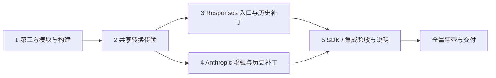

# Protocol Conversion Implementation Plan

> **For agentic workers:** REQUIRED SUB-SKILL: Use superpowers:subagent-driven-development (recommended) or superpowers:executing-plans to implement this plan task-by-task. Steps use checkbox (`- [ ]`) syntax for tracking.

**状态：用户已确认实施，进行中。** 本轮明确按本文开发直至集成验证成功；不新建 worktree 或分支。此前草稿只作参考，按实际结果逐项验收。

**Goal:** 在现有 core 内复用 RelayKit，新增无状态 Responses 并增强 Anthropic，保留现有部署、认证、会话归属及流式可靠性。

**Architecture:** 两个协议入口共用进程内传输层，转换后调用原 Chat Completions Handler。RelayKit 负责协议映射，宿主负责验证、取消、限制、真实用量与完成判定；必要库修正通过可移除小补丁完成。

**Tech Stack:** Go 1.26 系列、RelayKit 本地模块、现有 Go / Python / Node 测试及隔离 SDK。

**Spec:** [设计文档](../specs/2026-10-10-protocol-conversion.md)

**建议执行方式:** 逐任务实施及独立审查，使用 Superpowers 的 subagent-driven-development；依赖任务通过后再开始下一项。最终对整个变更再审查一次。用户可在实施确认时改选当前会话实施。

## Global Constraints

- 不修改 `upstream/` 或 `upstream-convert/`；既有快照文件和第三方库修正通过 `patches/`。
- RelayKit 固定本地 New API commit `0f38a14a5e8e322ea741478b0e49878be3130e1d`；保留原 module 路径、许可证与署名。
- 保持两个服务、同一账号池、无 HTTP 回环；只在 bridge 分支包装。
- 未知用量为 null、真实零保留、采用最后明确累计值；不伪造成功终态。
- 请求限制使用现有配置；JSON 响应和 SSE 累计上限均为 32 MiB，SSE 单帧 8 MiB。
- 保留认证、owner 上下文、取消；不调用真实上游、不重启实际服务。
- 不新增 Files API、response 存储、后台工具执行、JSON Schema 修复或管理业务。
- 所有文档/中间记录位于 `docs/superpowers`；保留原有 `.gitignore`、探测报告和 `upstream-convert/`。
- 不自动发布、推送、部署；确认实施只授权本地开发和隔离验证。

## Review Focus

1. finish_reason 后的 usage 必须更新最终输出，0 可覆盖旧值；缺失字段不得清除旧值（Task 2）。
2. 自定义/并行工具与并发请求需要独立状态；ID、参数及下一轮历史不能丢失（Task 3、4）。
3. 半帧、错误体、无限小帧、写入/flush 失败不能产出成功终态（Task 2）。
4. 公共私有字段/头不得伪造会话；DTO 的 any 字段也必须验证（Task 2、4）。
5. 无 bridge、现有 OpenAI 与管理 Messages/owner/CSRF 路径不能回退（Task 4、5）。

## 依赖顺序



## Task 1: 固定第三方模块并接入构建

**Files:** `extensions/third_party/relaykit/` 及来源/摘要清单；`patches/0008-relaykit-module.patch`、`patches/series`、`patches/README.md`、`deploy/core.Dockerfile`、`scripts/check.sh`、`desktop/scripts/prepare.py`、`desktop/scripts/test_prepare.py`。

**Interfaces:** 本地 `require github.com/QuantumNous/new-api/relaykit v0.0.0` 与 `replace ... => ./third_party/relaykit`；模块补丁使 core 达到 Go 1.26 基线。原始库接口保持不变。

- [ ] **核对来源并复制。** 核对源 commit 与工作区状态，复制独立模块的受版本控制文件和 LICENSE/NOTICE，记录每个原始文件 SHA-256；保留用户源目录。已归档草稿不能替代来源核对。
- [ ] **建立依赖补丁。** 用尚不存在的 `.build/protocol-deps-<编号>` 物化目录修改 go.mod/go.sum，再生成补丁；另一新目录重新 prepare，确认本地 replace 生效，不从远端选择其他 RelayKit 版本。
- [ ] **先补打包失败测试。** `test_resources_include_relaykit_notices_and_source_provenance` 调用真实复制函数，断言声明内容字节一致且不混入库源码；运行 `python -m unittest discover -s desktop/scripts -p test_prepare.py -v`，先观察缺少复制行为的失败。
- [ ] **最小实现构建/声明接入。** core 构建镜像升至 Go 1.26 系列，独立 test/vet 嵌套模块；Docker 与桌面资源含 LICENSE/NOTICE/来源清单。console 工具链、Compose 不变。
- [ ] **验证。** 新物化 `.build/protocol-check-1`；运行 `go -C .build/protocol-check-1/third_party/relaykit test ./...`、同目录 `vet ./...`、`go -C .build/protocol-check-1 test ./...` 及前述 Python 测试；预期全部退出 0。
- [ ] **记录与审查。** 保存命令、结果、快照摘要；审查模块边界及打包，确认没有账号、密钥或 New API 宿主服务。

## Task 2: 建立共用 RelayKit 传输层

**Files:** 新增 `extensions/internal/protocol/adapter.go`、`stream.go`、`usage.go`、`responses_validation.go` 及对应 `_test.go`。Task 4 添加 `claude_validation.go`；本任务只保留 Claude 文本的必要验证，不开放增强入口。

**Interfaces:**

```go
func Serve(w http.ResponseWriter, r *http.Request, next http.Handler,
    apiKey string, maxBodyBytes int64, format types.RelayFormat, conversationID string)
func WriteError(w http.ResponseWriter, code int, message string, format types.RelayFormat)
```

format 仅为 RelayFormatOpenAIResponses 或 RelayFormatClaude。Serve 负责有界解析、验证、转换及 next 调用；调用方负责路由/方法/认证/协议头。conversationID 仅由可信 context 提取。错误包不能透出原始上游诊断内容。

- [ ] **先写请求边界失败测试。** `TestRequestIsolationAndConvertedLimit` 断言 context 取消/owner 保留、公共私有头剥离、转换体超限不调用 next。`TestInvalidRequestsDoNotReachHandler` 覆盖 null、尾随 JSON、空模型、非法布尔值/嵌套结构及私有字段，预期 400。
- [ ] **实现请求转换。** 公开 ConvertRequest，每请求新建 convmeta.Values 并跨两端复用；safe 策略后检查完整 diagnostics。处理无状态参数，输出上限映射 max_tokens，重建请求后进程内调用 next。
- [ ] **先写响应/用量失败测试。** `TestUnknownUsageRemainsNull`、`TestLateZeroUsageWins`、`TestPartialUsagePreservesObservedFields`、`TestNonStreamingErrorIsSanitized` 分别断言 null、输入 0/输出 2、最后明确值及脱敏。total 最后明确值优先（包括 0），从未提供才在两项均已知时求和。
- [ ] **实现普通响应。** 至多 32 MiB 捕获 next；验证 choice、finish_reason、usage 后调用 ConvertResponse，序列化时用原始 presence 修正用量。
- [ ] **先写流式失败测试。** `TestFirstDeltaIsImmediate` 在 next 未返回时检查文本已输出；`TestTerminalWaitsForLateUsage` 在 finish 后检查尚无终态；`TestTruncatedStreamCannotComplete` 覆盖 DONE 无 finish、残帧、错误包、finish 后 choice 和 DONE 后 data。
- [ ] **补状态、取消、容量测试。** `TestIncompleteFinishReasons` 断言 length/content_filter 的 Responses 为 incomplete；未知 reason 失败。`TestWriteAndFlushFailureCancelNext`、`TestStreamTotalLimit` 覆盖短写/写入/Flush 失败、8 MiB 单帧和 32 MiB 累计上限，断言取消传到 next 且无成功终态。
- [ ] **实现 SSE 转换。** 有界逐帧解析并记录 finish/usage，内容去掉两者后喂库；Claude 的 reasoning/text/tools 混合 delta 拆分。正常 EOF 且 finish 合法后合成终止 chunk 再 Finalize，覆盖 nullable usage；Responses 开启 sequence_number。
- [ ] **验证。** 每批测试先 RED 再 GREEN；新物化 `.build/protocol-check-2`，执行该目录 `go test ./internal/protocol`、`go test -race ./internal/protocol`、`go vet ./internal/protocol`。环境不能运行 race 时记缺口，不写通过。

## Task 3: 接入 Responses 创建接口及明文历史

**Files:** `extensions/internal/responses/adapter.go`、`adapter_test.go`、`extensions/cmd/server/extension.go` 及 wiring 测试；`patches/0009-relaykit-responses-history.patch`（含库回归测试）、`patches/series`、`patches/README.md`。

**Interfaces:** `responses.New(next http.Handler, apiKey string, maxBodyBytes int64) http.Handler`。仅截获 `/v1/responses`；认证为单个 Authorization Bearer。其他请求原样交给 next，无 bridge 不包装。

- [ ] **先写路由失败测试。** POST 文本/工具/图片/schema 经 New 到达 `/v1/chat/completions`；GET 为 405，重复/错误认证为 401，models/chat 路径不变。
- [ ] **实现入口并接线。** 使用 Serve/WriteError；保持 Handler 和 bridge context。沿用明确的 query、压缩体限制。
- [ ] **先写工具状态失败测试。** function_call_output 保留 call_id；custom 工具依靠请求元数据在响应中恢复；两个并发请求的名称/参数不串。
- [ ] **先写 reasoning 回传失败测试。** 将生成的 reasoning.summary、assistant 文本和 function_call 作为下轮 input；断言 reasoning_content 和工具关联均保留。encrypted/opaque reasoning 必须在调用 next 前 400。
- [ ] **制作最小历史补丁。** 只补 Responses 明文 reasoning 请求映射；原始快照保持不变，补丁附测试及移除条件。重物化确认原先 RED 的测试 GREEN。
- [ ] **验证完整响应与流。** 文本/推理/工具、length 状态、连续序号及 final output 聚合一致；store/background true 和 previous_response_id 等为 400，false 可用。
- [ ] **验证。** 新物化 `.build/protocol-check-3`，运行库 `test ./...` 以及 `go -C .build/protocol-check-3 test ./internal/responses ./internal/protocol ./internal/server ./cmd/server`；预期退出 0。

## Task 4: 增强 Anthropic 并修正混合历史

**Files:** `extensions/internal/anthropic/adapter.go`、`stream.go`、现有测试和新增 `conversion_test.go`；`extensions/internal/protocol/claude_validation.go` 及测试；`patches/0010-relaykit-claude-history.patch`（含库回归）、`patches/series`、`patches/README.md`。

**Interfaces:** 保持 anthropic.New、WithConversation、bridge envelope。`validateClaudeRequest(raw []byte, input *dto.ClaudeRequest) error` 负责嵌套形状验证，不承担协议转换。

- [ ] **先补入口失败测试。** `TestToolDefinitionsCallsAndResults`、`TestImagesAndGenerationParameters`、`TestThinkingOutput`、`TestToolStreamKeepsLateZeroUsage` 在旧文本实现上确认失败，记录失败原因。
- [ ] **先写库缺口失败测试。** 完整 assistant text+tool_use 历史和随后 tool_result，断言 Chat 同时保留文本、tool_calls、关联 ID；无签名明文 thinking 保留 reasoning_content。原始库应失败。
- [ ] **制作最小库补丁。** 只修该方向已证实的内容丢失，保持公开 API/模块路径；回归与改动一并写入 0010。外部非空 signature/redacted 块由宿主返回带路径 400，不伪造或悄悄删除。
- [ ] **替换文本转换与旧传输。** 保留 x-api-key/version/beta/query/compression 检查；读取可信 context 会话后调用 Serve。仅删除共享层已替代的代码。
- [ ] **完善验证及旧测试。** 保留 malformed/null/角色/缺字段/未知字段/非法图片校验；只移除因能力扩展过时的“工具/图片/参数必拒绝”断言。认证、取消、owner、未知/晚到用量及错误回归保留。
- [ ] **验证。** 新物化 `.build/protocol-check-4`，运行库 `test ./...`，以及 core `test ./internal/anthropic ./internal/protocol ./internal/bridge ./cmd/server` 和相关包 race；新增及现有契约均须通过。

## Task 5: SDK、隔离验收、说明与最终审查

**Files:** `scripts/check_anthropic_sdk.py`、新增 `scripts/check_responses_sdk.py`、`scripts/acceptance.sh`、`deploy/mock_upstream.py`；`README.md`、`AGENTS.md`、`console/web/app.js` 与已有 API 提示/署名位置、`docs/superpowers/verification/`。

**Interfaces:** SDK 仅用于临时测试环境，不进入生产依赖；复用隔离 console → core → mock 链路。Responses SDK 的验收版本在测试脚本依赖说明中锁定并记录实际版本。

- [ ] **SDK 先补失败断言。** Anthropic 保留 null/晚到 usage、raw events、text_stream、最终聚合，增加工具。Responses 覆盖 create、stream 事件/最终对象、自定义工具 ID 和参数。传输测试不代替 SDK 验收。
- [ ] **扩展隔离集成。** 实际 console/core 连 mock 检查两协议，保留 OpenAI 流式及管理 owner/CSRF/取消断言；不使用真实账号。
- [ ] **更新说明。** README 面向使用者写端点/curl/能力范围；AGENTS 记录目录与验证方式；页面修订“仅文本”提示，保留模型依赖和 beta 限制及第三方署名。无新增交互业务。
- [ ] **执行检查并记录退出码。** 命令如下；SDK 的临时 Python 路径和锁定版本写入记录，未执行的单独标记。

```text
python -m unittest discover -s scripts -p test_*.py -v
python -m unittest discover -s deploy -p test_*.py -v
python -m unittest discover -s desktop/scripts -p test_*.py -v
bash scripts/check.sh
docker compose --env-file /dev/null -f docker-compose.yml config --quiet
bash scripts/acceptance.sh
git diff --check
```

带 `/dev/null` 的命令在可用 Bash/Linux 环境执行。SDK 环境沿用既有隔离方式，Anthropic 使用现有 WB2A_SDK_PYTHON；Responses 解释器以相同机制传入。不为测试改变宿主全局环境或重启实际服务。

- [ ] **独立审查。** 审查整个 diff 与 Review Focus，确认无新增服务/会话绕过/数据或密钥混入；关键问题先复现失败、最小修正、复验。
- [ ] **交付。** 说明修改、实际测试、未做项目及能力限制；保留用户原改动。Docker 不可用或 SDK 未执行即对应验收未完成，不声称已发布/部署。

## 实施前确认

请用户审阅设计和本计划，确认是否按本范围实施，并选择推荐的“逐任务实施与独立审查”或“当前会话实施、最后独立审查”。收到确认前只允许修订文档和只读核对。

## 文档自检

- 每项设计能力有任务与验收归属；Files/持久化/工具执行/schema 修复无实施任务。
- Task 1 提供模块，Task 2 提供 Serve/WriteError，Task 3/4 消费相同接口；历史缺口分别有补丁和失败回归。
- 此前草稿和 RED 记录不计为完成；实施确认后重新按步骤验证。
