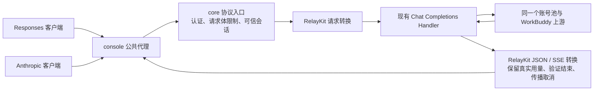
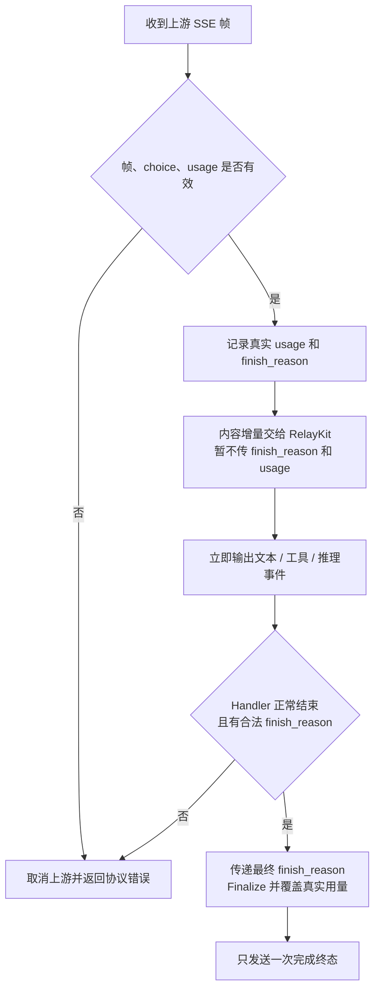

# Responses / Anthropic 协议转换设计

**状态：本地开发、评审及隔离集成验收已完成。** 实施阶段未创建 worktree 或新分支；开发和隔离验证未改变实际服务。证据见 `../verification/protocol-conversion-completion-audit.md`。

## 目标与取舍

复用本地 New API RelayKit，新增 Responses 并增强 Anthropic，使使用这两种协议的客户端可以调用本项目已有模型。以这份 RelayKit 快照能够转换的语义为基准；不追求 DeepSeek 文档全部能力，不等同于完整 OpenAI / Anthropic 平台，也不保证全部客户端兼容。

| 方案 | 结果 | 选择 |
| --- | --- | --- |
| core 内复用 RelayKit 独立模块 | 两个服务不变，复用字段与事件转换；宿主补传输约束 | 采用 |
| 新增第三方协议服务 | 多一层网络、部署和配置 | 不采用：不符合已确认部署范围 |
| 项目自行编写全部转换 | 维护两套协议状态机 | 不采用：不符合复用要求 |

## 请求与响应路径

## 能力边界

| 能力 | 转换层负责 | 上游或其他服务负责 |
| --- | --- | --- |
| 文本、多轮历史、普通 JSON、SSE | 格式、事件顺序、错误包、完成状态 | 生成内容 |
| function 工具、tool_result、Responses custom 工具 | 定义、参数、call_id、工具回填、每请求状态 | 模型选择/生成工具调用；客户端执行工具 |
| 图片 URL、可转换的内联文本/PDF | 转换库支持的内容形状；内联内容有界解析，不抓取远程文件 URL | 读取及理解；不保证所有模型支持 |
| reasoning / thinking | 请求意图和上游实际返回的推理内容映射 | 是否输出推理及可用档位 |
| JSON Schema / JSON 模式 | 转换到上游字段并保留约束 | 是否严格遵守；网关不验证修复生成结果 |
| Files API / 上传 / file_id 仓库 | 本次不提供；无法解析的引用明确报错 | 以后独立建设或使用有相应能力的上游 |
| previous_response_id / 持久化 response / 后台任务 | 本次不提供，有状态请求明确报错 | 不在本次范围 |

### 路由与参数

- 继续两个服务、进程内调用、一条 Compose 启动命令；无 HTTP 回环、额外数据库或账号池。
- `POST /v1/responses` 提供无状态输入、文本、工具调用/回填、库支持的图片与推理映射、普通响应和增量 SSE。
- `/v1/messages` 从文本子集扩展至 RelayKit 的 Messages 转换范围；保留 x-api-key、固定版本、可信内部 conversation_id、管理会话隔离。
- Responses 只新增 POST 创建接口，不新增检索、删除、取消、compact 或 WebSocket 接口。客户端携带完整历史，无状态调用。
- `previous_response_id`、`conversation`、模板 `prompt`、需要服务端状态的 `context_management` 明确返回 400；`store:true`、`background:true` 同样拒绝，缺省/false 按无状态同步语义处理。响应不宣称已持久化。
- Anthropic 继续要求 `x-api-key` 与 `anthropic-version: 2023-06-01`；保留现有 `anthropic-beta`、查询参数、压缩请求体的拒绝规则，不宣传完整 Claude Code 兼容。
- 工具或媒体转换损失采用 RelayKit `safe` 策略，并检查最终聚合 diagnostics；无法表达的关键内容返回带字段路径的 400，不把“静默丢字段”当成兼容成功。无损的库支持参数正常转换；语义近似但非错误级别的限制在使用说明中列明。
- OpenAI 现有路径保持原行为；仅启用 bridge 的 core 包装协议适配器。

## 共享转换层的契约

### 请求与会话

1. 协议入口先执行对应认证，再调用共享层。未知顶层字段、非 UTF-8、尾随 JSON、null 对象、非法布尔值和缺失必填值返回 400。
2. 对 DTO 的 `any` / RawMessage 字段补必需形状检查：system、内容块、角色、工具定义、图片源；由库完成真正的字段映射，不另写协议转换器。
3. 每个请求创建一个 `convmeta.Values`，同一请求的 request、response、stream 共享；不同请求绝不复用。custom 工具恢复依赖这份状态。
4. 使用公开 `ConvertRequest` 注册入口，目标为 Chat Completions。Responses 输出上限适配为本项目已使用的 `max_tokens`；请求实际模型 ID 不作额外别名转换。
5. 克隆请求上下文、重建路径/请求体/最小请求头，直接调用既有 Handler。仅内部 bridge 注入的可信 context 可写 `conversationId`，公共 body/header 不得伪造。
6. 原始体和转换后的体均不得超过 `server.max_body_mb`；管理入口继续将 envelope 计入同一限制。

### 普通响应与流式响应

普通 JSON 保持现有 32 MiB 响应上限。校验上游成功状态、单个 choice、已知 finish_reason、结构与用量后，调用 `ConvertResponse`；错误内容统一脱敏，不透出上游响应头或原始错误体。

- 单帧 SSE 上限沿用 8 MiB；整条上游 SSE 累计上限为 32 MiB。RelayKit 会为最终 response 聚合内容，因此仅限制单帧不足以约束内存。
- 文本、推理与工具参数按增量转发。Claude 同一 chunk 中同时出现 reasoning、text、tool_calls 时拆分喂库，避免库只选择其中一个分支。最终完整 Handler 回归发现库在切换文本时会清除未完工具状态，因此工具开始后的交错 text/thinking 暂存至工具参数收齐，再按两者原相对顺序喂库；工具参数仍即时输出。暂存计入同一累计上限，失败或取消不输出成功终态。代价是该交错情形的文本/推理显示延迟，README 明确说明。
- 适配请求通过可信进程内 context 直接读取 Handler 收到的原始流，在旧 Stream/Aggregate 处理之前执行上述校验和限额；普通响应仅将验证后的帧交给现有聚合逻辑。原 Chat/no-bridge 路径不启用此行为。
- 使用 nullable 计数独立保存最后一次明确累计用量，0 可以覆盖旧值；晚到帧缺失的字段不清除已有值，从未提供的字段保持 null，不估算、不累加累计值。total 采用最后明确值（包括 0）；从未提供 total 时，仅输入/输出均已知才求和，否则 null。
- `finish_reason` 后仍接受 usage-only 帧；输出终态延迟至 Handler 正常返回。`[DONE]` 自身不证明成功；有合法 finish_reason 的正常 EOF 可接受，缺失 finish_reason、残帧、后续非法数据、取消、解析/写入/flush 错误均不得成功结束。
- 输出 Responses `sequence_number`；正常事件由库生成，Responses 推理按库的 summary 语义呈现，不另改成 DeepSeek 特有事件。
- 上游 finish_reason 只接受 stop、length、tool_calls、content_filter：Responses 的 length/content_filter 映射为 incomplete；不把所有终止都归为 completed。Anthropic 采用库支持的 stop 映射。未知 reason 拒绝；finish 后出现新的 choice 或 DONE 后出现任何 data 均失败。
- 首事件前失败返回对应协议 JSON 错误；首事件后失败发送协议错误事件并关闭。任一失败立即取消底层请求，不再发送 completed/message_stop。

## 必要的库修正与维护

当前本地快照的静态检查发现两类不能直接照搬的行为：

| 问题 | 本项目处理 |
| --- | --- |
| 默认用量补零、可能提前发完成事件 | 由上述共享传输层修正，不改库事件转换器 |
| Claude assistant 同时含 text 与 tool_use 时丢文本；历史 thinking 被忽略 | 为库维护最小补丁与回归：保留可表达的文本/工具/明文 reasoning；无法表达的 opaque/redacted/signature 语义明确报错，禁止伪造签名 |
| Responses 输出的明文 reasoning.summary 回填时被当作普通消息 | 最小请求映射补丁保留 summary 到 Chat reasoning_content；encrypted/opaque 内容返回带路径的 400 |

历史修正是为了保证客户端把本项目输出作为下一轮历史传回时不会丢信息；不扩展成自行维护一套协议。本项目生成的无签名明文 thinking/summary 必须可回传；外部非空签名、redacted/encrypted 内容在调用 Handler 前拒绝。补丁需有原始快照上的失败测试，以及补丁后的通过记录。后续引入等价库修复时可以移除。

### 第三方来源与工具链

- 来源：用户提供的 `upstream-convert/relaykit`，其所属 New API commit 为 `0f38a14a5e8e322ea741478b0e49878be3130e1d`。实施前再次核对，禁止静默换成远端最新版本。
- 保持原 module 路径 `github.com/QuantumNous/new-api/relaykit`，完整复制独立模块的源码、测试及 go.mod/go.sum；不复制 New API 宿主 UI、数据库和调度器。
- `extensions/third_party/relaykit` 保存未修改快照和 SHA-256 manifest；core go.mod 使用本地 replace。库修正经 `patches/` 应用于临时物化目录，不改 `upstream/` 或 `upstream-convert/`。
- 保留原 LICENSE/NOTICE、来源与随包声明；管理页使用已有说明位置展示所需署名链接，不新增管理业务。
- Go 满足库的 1.25.1 下限，core 构建基线采用项目桌面 CI 已使用的 1.26 系列；console 模块无需为此升级。独立嵌套模块必须单独 test/vet，根模块 `go test ./...` 不会自动覆盖它。
- 镜像和桌面打包均携带第三方声明；Compose 服务数、端口、数据挂载和运行配置不变。

## 实现单元

| 单元 | 责任 |
| --- | --- |
| extensions/third_party/relaykit | 可追溯、可独立测试的原始库快照 |
| extensions/internal/protocol | 两种格式复用 RelayKit 的请求/响应转换及有界传输；仅修正宿主用量、结束、取消语义 |
| extensions/internal/responses | Responses 路由和 Bearer 认证 |
| extensions/internal/anthropic | 既有路由、认证和可信会话入口，调用共享转换器 |
| extensions/cmd/server/extension.go | 在现有桥接分支接线 |
| patches、deploy、scripts、desktop | 模块依赖、库小补丁、工具链、独立库测试及随包声明 |

## 验证

| 验收组 | 完成条件 |
| --- | --- |
| 基础协议 | 文本、多轮、JSON、SSE、模型名、最大输出参数均保留；SDK 能解析最终聚合对象 |
| 工具与推理 | 调用/回填的 ID、名称、参数及并行顺序保留；自定义工具跨请求不串状态；混合历史回传无静默丢失 |
| 输入边界 | 非法输入与不支持状态有明确 400；认证、可信会话、原始/转换后体积限制通过 |
| 流式可靠性 | 首块实时、序号连续、晚到/未知/零用量正确；截断、取消、写入失败均无成功终态；累计限制能停止无限小帧流 |
| 既有行为 | OpenAI 路径、无 bridge 模式、管理 Messages/owner/CSRF 回归通过 |
| 交付 | core 与库 test/vet、关键包 race、console、Node/Python、SDK、隔离容器验收各有实际结果；文档不夸大兼容范围 |

先写失败回归，再最小实现。真实 Handler 与隔离 mock 用于检查集成；真实上游模型能力不由 mock 结果证明。之前的真实探测记录仅作背景，本阶段不再消耗账号额度。

Docker 隔离验收必须实际执行；若引擎不可用，报告该项未执行，不将构建/容器交付标为全部验证。此设计不授权发布镜像、推送 Git、部署或重启实际服务。
